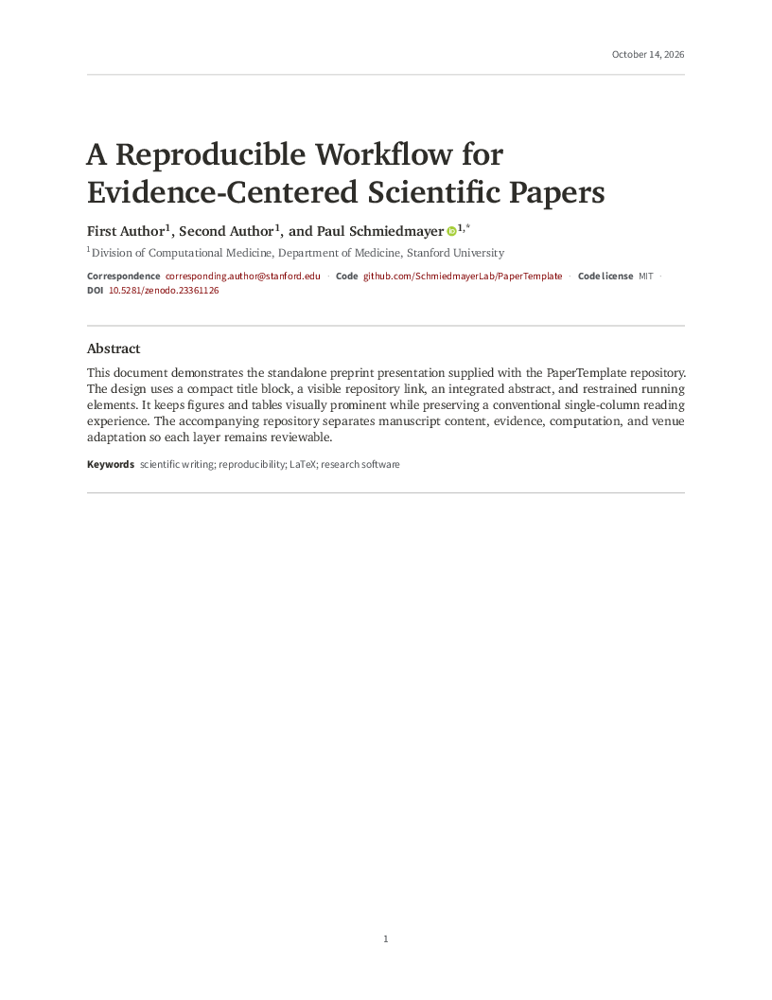
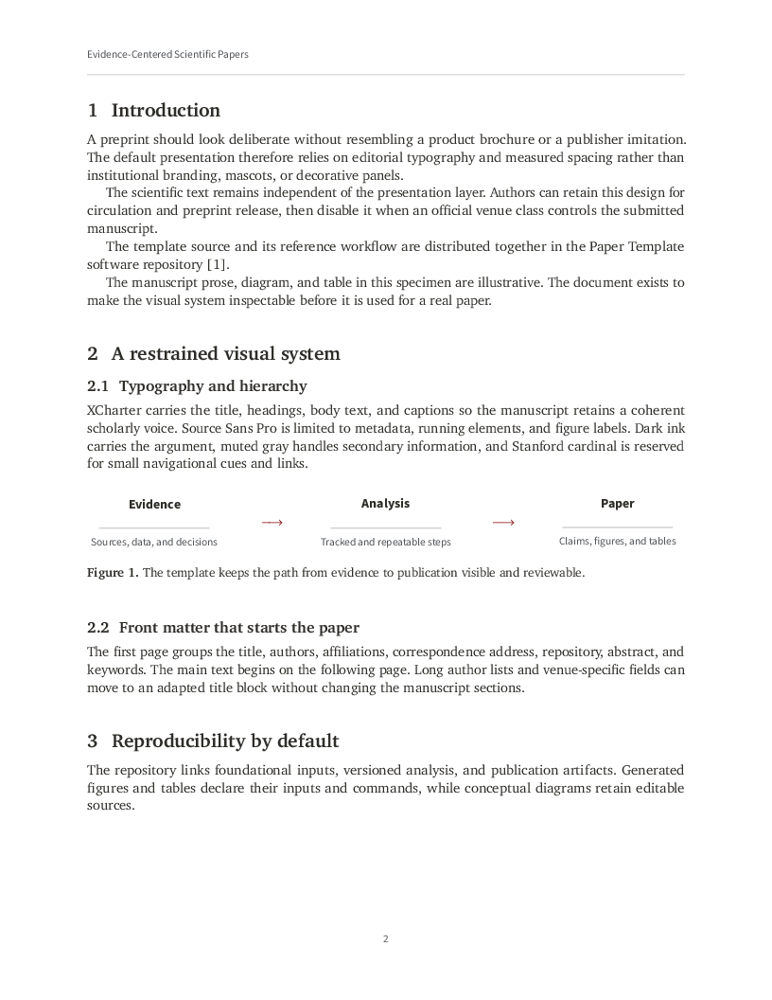

<!--

This source file is part of the Paper Template open-source project

SPDX-FileCopyrightText: 2026 Schmiedmayer Lab and the project authors (see CONTRIBUTORS.md)

SPDX-License-Identifier: MIT

-->

# A Reproducible Workflow for Evidence-Centered Scientific Papers

[](https://github.com/SchmiedmayerLab/PaperTemplate/actions/workflows/validate.yml)
[](https://api.reuse.software/info/github.com/SchmiedmayerLab/PaperTemplate)
[](LICENSE.md)
[](https://doi.org/10.5281/zenodo.23361126)

*A LaTeX template for reproducible research and agent-assisted writing.*

Write scientific papers in LaTeX with source-derived references, reproducible figures, and a checked arXiv source export.
This template includes a single-column preprint layout, modular manuscript sections, and automated checks.
Use the writing and review instructions with an agent if useful; the manuscript and build tools work without one.

[Get started](#quick-start) · [Workflow shortcuts](#workflow-shortcuts) · [View the layout demo PDF](project/assets/previews/preprint-preview.pdf) · [Publication workflow](project/guides/publication-workflow.md) · [Cite the template](#citation)

| Title and abstract | Main text |
| --- | --- |
| [](project/assets/previews/preprint-preview.pdf) | [](project/assets/previews/preprint-preview.pdf) |

The [layout demo](paper/preprint-preview.tex) uses illustrative content to show the journal-neutral preprint style.
See the [presentation guide](paper/README.md#preprint-presentation) for customization and the [complete demo PDF](project/assets/previews/preprint-preview.pdf).

## Quick start

You need Python 3.10 or newer, Make, and a TeX distribution with `latexmk` and BibTeX.
Ghostscript is also required for arXiv export and [documentation preview generation](project/assets/previews/README.md).

1. Select **Use this template → Create a new repository** on GitHub, then clone your new repository and open its directory.
2. Edit the title and authors in [metadata.tex](paper/setup/metadata.tex), then write in the [manuscript sections](paper/sections/).
3. Check your tools and build:

   ```bash
   make doctor
   make all
   ```

Open the generated `build/main.pdf`; draft-placeholder warnings are expected until you replace the starter text.
For a local layout demo, run `make preview-pdf` and open `build/preprint-preview.pdf`.

Follow the [customization checklist](project/guides/customization-checklist.md) to replace template metadata, review licensing, and [acknowledge the template](project/guides/customization-checklist.md#citing-this-template).
Define your contribution in the [project brief](project/notes/00_project_brief.md) and record [venue requirements](project/notes/01_venue_requirements.md) before adapting the paper.

## Workflow shortcuts

| Workflow | What it provides | Start with |
| --- | --- | --- |
| [Manuscript builds](paper/README.md) | Full-paper PDFs and standalone sections with citation checks. | `make pdf` or `make subfile` |
| [Reproducible figures and tables](project/guides/reproducibility-workflow.md) | Regenerated artifacts with recorded input and output checksums. | `make reproduce` |
| [External research code](research/reproducibility/submodules.md) | Pinned repositories for analysis, evaluation, and software under study. | `make submodules` and `make submodule-check` |
| [References](project/guides/reference-workflow.md) | A bibliography rebuilt from saved citation files and checked for consistency. | `make references` |
| [Author contributions](project/guides/contributor-roles.md) | CRediT statements generated from roles confirmed by each author. | `make contributions` |
| [Word review](project/guides/word-review.md) | Editable Word copies and tools to compare returned edits with the LaTeX source. | `make word`; see the guide for `make word-review` |
| [Submission readiness](project/notes/05_submission_checklist.md) | Checks for unresolved draft content, references, and reproducibility gaps. | `make check`, then `make submission-check` |
| [arXiv preparation](project/guides/arxiv-submission.md) | A minimal source ZIP, an isolated rebuild, and a page-by-page rendered comparison. | `make arxiv`; use `make arxiv-check` for a draft smoke test |
| [Repository compliance](project/guides/customization-checklist.md#licensing) | License metadata and Markdown link checks. | `make compliance` |

The [Makefile](Makefile) lists all targets, including `make clean` for LaTeX auxiliary files.
Generated outputs and local research material are [ignored by Git](.gitignore).
The [README previews](project/assets/previews/README.md) are committed so they display on GitHub.
The [validation workflow](.github/workflows/validate.yml) checks the repository, LaTeX builds, and arXiv packaging; [repository standards](.github/workflows/repository-standards.yml) cover licensing, links, and workflow conventions.
See the [CI maintenance notes](tools/README.md#continuous-integration) for compiler versions and required checks.

## Repository map

| Location | Purpose |
| --- | --- |
| [main.tex](main.tex) | Full-manuscript entry point. |
| [references.bib](references.bib) | Generated bibliography; update its [source citation assets](research/literature/) through the [reference workflow](project/guides/reference-workflow.md). |
| [paper/](paper/README.md) | Manuscript sections, figures, tables, metadata, and presentation. |
| [research/](research/README.md) | Literature, data, analysis, and reproducibility records. |
| [project/](project/README.md) | Planning notes, evidence decisions, feedback, and publication guides. |
| [tools/](tools/README.md) | Automation scripts, tests, and optional review workflows. |

## Documentation

- [Publication workflow](project/guides/publication-workflow.md): plan, write, review, and submit a paper.
- [Article profiles](project/guides/article-profiles.md) and [domain checklists](project/guides/domain-checklists.md): choose a structure and reporting requirements that fit the work.
- [Venue adaptation](project/guides/venue-adaptation.md): apply an official journal class while preserving manuscript content.
- [Paper skills](tools/skills/README.md) and [working instructions](AGENTS.md): optional literature, writing, review, and consistency workflows.

## Contributing

Contributions to this project are welcome. Please make sure to read the [contribution guidelines](https://github.com/SchmiedmayerLab/.github/blob/main/CONTRIBUTING.md) and the [contributor covenant code of conduct](https://github.com/SchmiedmayerLab/.github/blob/main/CODE_OF_CONDUCT.md) first. You can find a list of contributors in the [CONTRIBUTORS.md](CONTRIBUTORS.md) file.

## License

This project is licensed under the MIT License. See [LICENSE.md](LICENSE.md) for more information.

## Citation

If you use this software, please cite it using the metadata in [CITATION.cff](CITATION.cff), which GitHub surfaces through the [*Cite this repository*](https://docs.github.com/en/repositories/managing-your-repositorys-settings-and-features/customizing-your-repository/about-citation-files) button.

> Schmiedmayer, P. (2026). *A Reproducible Workflow for Evidence-Centered Scientific Papers* [Software]. Zenodo. [https://doi.org/10.5281/zenodo.23361126](https://doi.org/10.5281/zenodo.23361126)

When adapting this template, retain its [source citation](research/literature/schmiedmayer2026papertemplate/citation.bib) and brief [manuscript acknowledgment](paper/sections/90_acknowledgments.tex), even when replacing [CITATION.cff](CITATION.cff) with your paper's metadata.
Provide any venue-required disclosure separately.

## Our Research

For more information, visit the [Schmiedmayer Lab GitHub organization](https://github.com/SchmiedmayerLab).


