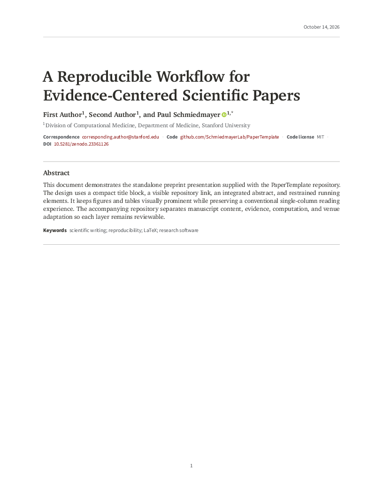
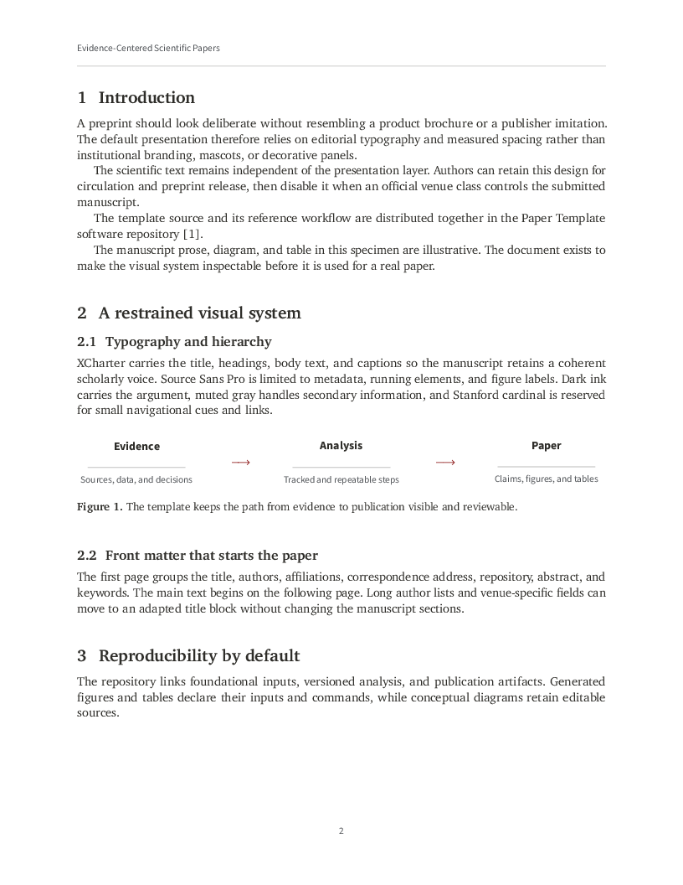

<!--

This source file is part of the Paper Template open-source project

SPDX-FileCopyrightText: 2026 Schmiedmayer Lab and the project authors (see CONTRIBUTORS.md)

SPDX-License-Identifier: MIT

-->

# A Reproducible Workflow for Evidence-Centered Scientific Papers

*A LaTeX template for reproducible research and agent-assisted writing.*

[](https://github.com/SchmiedmayerLab/PaperTemplate/actions/workflows/validate.yml)
[](https://api.reuse.software/info/github.com/SchmiedmayerLab/PaperTemplate)
[](LICENSE.md)
[](https://doi.org/10.5281/zenodo.23361126)

Write scientific papers in LaTeX with source-derived references, reproducible figures, and a checked arXiv source export.
PaperTemplate provides a single-column preprint layout, modular manuscript sections, and automated checks.
Use the writing and review instructions with an agent if useful; the manuscript and build tools work without one.

[Get started](#quick-start) · [View the layout demo PDF](project/assets/previews/preprint-preview.pdf) · [Publication workflow](project/guides/publication-workflow.md) · [Cite the template](#citation)

| Title and abstract | Main text |
| --- | --- |
| [](project/assets/previews/preprint-preview.pdf) | [](project/assets/previews/preprint-preview.pdf) |

These pages come from the [layout demo](paper/preprint-preview.tex), which has its own illustrative prose, diagram, and table.
The demo does not use the placeholder manuscript sections and does not report a research study.
The preprint layout is journal-neutral; use the target venue's official class for submission when required.

## Quick start

You need Python 3.10 or newer, Make, and a TeX distribution with `latexmk` and BibTeX.
Ghostscript is also required for arXiv export and documentation preview generation.

1. Select **Use this template → Create a new repository** on GitHub, then clone your new repository and open its directory.
2. Edit the title, authors, affiliations, and correspondence in [paper/setup/metadata.tex](paper/setup/metadata.tex), then start writing in [paper/sections/](paper/sections/).
3. Check your tools and build the manuscript:

   ```bash
   make doctor
   make all
   ```

Open `build/main.pdf` to see your paper.
Draft-placeholder warnings are expected until you replace the starter text.
To inspect the design without editing a manuscript, run `make preview-pdf` and open `build/preprint-preview.pdf`.
Write your paper in `main.tex` and `paper/sections/`; `paper/preprint-preview.tex` is only the layout demo.

## Set up your paper

Once the first build works, follow the [customization checklist](project/guides/customization-checklist.md):

- Update contributors, licensing, and manuscript citation metadata while retaining the template attribution.
- Define the contribution and article profile in [the project brief](project/notes/00_project_brief.md), and record [venue requirements](project/notes/01_venue_requirements.md).
- Add references through the [reference workflow](project/guides/reference-workflow.md), rather than editing generated `references.bib`.
- If your paper uses data or analysis, register its inputs and generating commands in the [reproducibility workflow](project/guides/reproducibility-workflow.md).
  Initialize external repositories with `make submodules` when applicable.

Write one sentence per source line and run `make all` while drafting.
Before submission, run `make submission-check`; use `make arxiv` to create and validate a source ZIP.
The Python scripts use only the standard library.
Standalone section builds include the citations used by that section; final-log checks reject unresolved citations and references even when a PDF was created.
REUSE and Linkspector are optional locally and enforced by the configured GitHub workflows.

## Repository map

The repository has four working areas around two visible manuscript entry points:

```text
main.tex                 Full-manuscript entry point
paper/preprint-preview.tex
                         Self-contained visual specimen for the preprint profile
references.bib           Generated LaTeX bibliography
paper/                   Manuscript content and presentation
research/                Evidence, computation, and reproducibility records
project/                 Paper-specific decisions and reusable guidance
tools/                   Automation, tests, and agent workflows
```

Start in `paper/` when writing or reviewing the manuscript.
Use `research/` when tracing a claim or regenerating an artifact.
Use `project/` for planning and publication decisions.
Use `tools/` only when running or maintaining the workflow.
Each area has a short README that defines its internal structure and boundary.

## Reproducible figures and tables

Track authorized foundational data under `research/data/source/` and redistributable external data under `research/data/external/`.
Keep restricted data outside Git under the ignored `research/data/restricted/` path or another governed location.
Record every foundational or external input in `research/data/manifest.tsv`.

Every data-derived figure and table must identify its input files, generating command, environment, outputs, and manuscript locations in `research/reproducibility/pipeline.json`.
Conceptual diagrams must retain editable source and a documented export command.
Generated outputs belong under `paper/figures/generated/`, `paper/tables/generated/`, `research/data/interim/`, or `research/data/derived/` and remain ignored by default.

Run:

```bash
make reproducibility-check
make reproduce
make pdf
make preview-pdf
make subfile SUBFILE=paper/sections/10_introduction.tex
```

An empty pipeline runs zero scientific steps; passing repository checks alone does not establish reproduction of a paper's results.
The runner writes input and output checksums to the ignored `build/reproducibility-run.json` record.
The full policy and clean-clone verification process are documented in `project/guides/reproducibility-workflow.md`.

## External evaluation and software repositories

Use Git submodules when analysis scripts, evaluation tooling, software under study, or a versioned data package is maintained elsewhere.
Place each submodule where it is consumed, such as `research/analysis/external/<repository>/`, `research/software/<repository>/`, or `research/data/external/<repository>/`.
Register its repository URL, role, version label, exact commit, license, and manuscript use in `research/reproducibility/submodules.tsv`.

The superproject pins the exact commit.
Do not use a floating branch as the reproducible version.
Initialize and verify dependencies with:

```bash
make submodules
make submodule-check
```

Pipeline steps should reference the pinned submodule files directly.
CI checks out submodules recursively and records their revisions in the reproduction run record.

## Build and validation commands

```bash
make doctor
make submodules
make submodule-check
make check
make reproducibility-check
make reproduce
make pdf
make subfile SUBFILE=paper/sections/10_introduction.tex
make references
make compliance
make submission-check
make arxiv
make clean
```

The PDF is written to `build/main.pdf`.
The design specimen is written to `build/preprint-preview.pdf`.
The `subfile` target changes into the source directory before compiling and writes its output to `build/`.
Use that target rather than invoking `latexmk paper/sections/<file>.tex` from the repository root.
Build outputs, derived artifacts, local source material, restricted data, and downloaded article PDFs are ignored to avoid stale results, repository bloat, and accidental redistribution.
The three [documentation preview assets](project/assets/previews/) are an explicit exception so GitHub can display them without a build or an external host.
Regenerate them from the design specimen with `make readme-previews`; do not edit them manually.

## arXiv source package

Run `make arxiv` after the manuscript passes the final submission checks.
The command builds a minimal ZIP from the compiler's recorded manuscript dependencies and the explicit path policy in `project/submission/arxiv.json`.
Select the manuscript license in arXiv; the default ZIP does not include or generate repository license or contributor files.
Review input-specific notice obligations and explicitly configure additional files only when needed.
It strips manuscript comments only in a temporary staged copy, includes the matching `main.bbl` instead of the full bibliography database, recompiles the extracted ZIP in isolation, and requires its rendered pages to match the repository build pixel for pixel.
The resulting archive, inventory, and SHA-256 checksum are written under `output/arxiv/`.
The staged source freezes the default `\today` date; use `make arxiv ARXIV_DATE=2026-10-13` to select an explicit release date without editing the manuscript.
Use `make arxiv-check` for a nonpublishing packaging and reference-label smoke test, including while the template contains draft placeholders.

The allowlist is intentionally narrower than the repository.
Project notes, research material, tools, CI configuration, editable figure sources, unused figures, and build artifacts cannot enter the ZIP merely because they exist in the checkout.
See `project/guides/arxiv-submission.md` for current arXiv requirements, configuration, licensing cautions, and the final upload review steps.

## Preprint presentation

`main.tex` uses the standalone preprint presentation by default.
The visual packages are isolated in `paper/setup/preprint-packages.tex`, and the style rules are isolated in `paper/setup/preprint.tex`.
The profile uses XCharter for the title, headings, manuscript body, and captions.
Source Sans Pro is limited to metadata, running elements, and figure labels.
The near-monochrome palette uses Stanford cardinal for small navigational cues and links.
The standard green ORCID mark appears only beside authors with a configured ORCID iD.
The presentation contains no institutional logos, decorative icons, proprietary fonts, or copied publisher assets.
The title and abstract occupy a dedicated opening page, with a date header and rule aligned to the running headers on later pages.
`\paperstartmaintext` starts the main text on a new page in the preprint profile and leaves pagination unchanged in venue-controlled builds.
References also start on a new page in the preprint profile, after any pending figures and tables.

Edit the semantic fields in `paper/setup/metadata.tex` rather than changing the title block directly.
Record a verified ORCID iD for each author who has one; an empty ORCID field remains available as a placeholder and renders no icon.
Use the optional brand, version, code-license, and DOI-label fields only when they communicate real manuscript metadata.
The repository label should show a readable path such as `github.com/organization/repository` rather than generic linked text.
The front matter, abstract, keywords, and bibliography style use hooks defined in `paper/setup/commands.tex` so a venue adapter can replace them without editing scientific section files.
The journal-neutral drafting default uses square-bracketed numeric citations, sorts and compresses grouped citations, and orders the bibliography by first citation.
Define `\papernatbiboptions` before loading `main.tex` when a venue requires another `natbib` citation mode.
Run `make preview-pdf` to render a complete design specimen with illustrative content, a figure, and a table.
The working preview in `build/` is ignored and is not a submission file.
The README links to a separately generated documentation snapshot.

## Reference workflow

Add a reference from a citation export, DOI, or PubMed identifier:

```bash
python3 tools/scripts/add_reference.py --citation-file ~/Downloads/citation.ris --key example2026reproducible
python3 tools/scripts/add_reference.py --doi 10.1000/example
python3 tools/scripts/add_reference.py --pmid 12345678
```

Attach full text only when access is lawful:

```bash
python3 tools/scripts/add_reference.py --doi 10.1000/example --pdf-file ~/Downloads/article.pdf
python3 tools/scripts/organize_references.py --keys example2026paper --download-missing-pdfs
```

Each reference folder contains the citation export, generated `abstract.md`, durable `claims.md`, and optionally an ignored `source.pdf`.
Metadata refreshes replace `abstract.md` but preserve `claims.md`.
Run `make references` to rebuild `references.bib` and update `project/notes/06_reference_inventory.md`.

## Adapting to a journal

Draft with the generic class until a venue is selected.
Record verified author instructions in `project/notes/01_venue_requirements.md`.
Download official class or template files into `paper/venue/` only when their license permits repository storage.
Adapt the document class and front matter without moving scientific section content.
Keep compatibility code in `paper/setup/venue.tex` so venue adaptation remains reviewable and reversible.
Define `\papervenuebuild` in a thin venue root before inputting `main.tex` to bypass the preprint presentation as a single unit.
The same root can set `\paperdocumentclass` and `\paperclassoptions` before it inputs `main.tex`.

```tex
\def\papervenuebuild{}
\def\paperdocumentclass{publisher-class}
\def\paperclassoptions{}
\def\papernatbiboptions{round,authoryear}
\input{main.tex}
```

Do not infer current venue requirements from an old example submission.
Do not apply the repository's MIT license to publisher files, external data, downloaded publications, or other third-party assets.

## Continuous integration

Repository checks, TeX Live 2026 PDF builds, and TeX Live 2025 arXiv validation run in parallel with independent checkouts.
The Repository Standards workflow runs licensing, Markdown link, workflow lint, and repository-surface checks once.
Require `Repository Checks`, `Build LaTeX Manuscript`, `Validate arXiv Package`, and all four `Standards / ...` checks in the main-branch ruleset.
When renaming or consolidating jobs, update the required check names without weakening the corresponding validation or other merge protections.

## Repository-local paper skills

The folders under `tools/skills/` use the Codex skill format.
Automatic discovery depends on the active agent environment.
When a skill is not discovered automatically, read its `SKILL.md` directly and follow its bounded workflow.
Do not install these skills into a personal skill directory without the user's request.

## Documentation

- `project/guides/publication-workflow.md` covers the publication lifecycle.
- `project/guides/reproducibility-workflow.md` covers data, analysis, and artifact traceability.
- `project/guides/reference-workflow.md` covers citation assets and lawful full text.
- `project/guides/article-profiles.md` maps common manuscript structures.
- `project/guides/domain-checklists.md` contains conditional clinical, software, AI, review, protocol, and qualitative guidance.
- `project/guides/customization-checklist.md` identifies drafting defaults that each paper must replace or verify.
- `project/guides/venue-adaptation.md` covers the final journal migration.

## Contributing

Contributions to this project are welcome. Please make sure to read the [contribution guidelines](https://github.com/SchmiedmayerLab/.github/blob/main/CONTRIBUTING.md) and the [contributor covenant code of conduct](https://github.com/SchmiedmayerLab/.github/blob/main/CODE_OF_CONDUCT.md) first. You can find a list of contributors in the [CONTRIBUTORS.md](CONTRIBUTORS.md) file.

## License

This project is licensed under the MIT License. See [LICENSE.md](LICENSE.md) for more information.
File-level copyright and license information follows [REUSE](https://reuse.software/), and the repository is registered with the [REUSE service](https://api.reuse.software/info/github.com/SchmiedmayerLab/PaperTemplate).
Run `make license-check` to validate the current checkout; the badge above reports the service status.

## Citation

Please cite the template using its project DOI, [10.5281/zenodo.23361126](https://doi.org/10.5281/zenodo.23361126), [CITATION.cff](CITATION.cff), or GitHub's [**Cite this repository**](https://docs.github.com/en/repositories/managing-your-repositorys-settings-and-features/customizing-your-repository/about-citation-files) button.

> Schmiedmayer, P. (2026). *A Reproducible Workflow for Evidence-Centered Scientific Papers* [Software]. Zenodo. https://doi.org/10.5281/zenodo.23361126

The project DOI is the default citation across releases.
For exact reproduction, also record the release tag or commit used; Zenodo provides a version-specific DOI when an immutable archive citation is needed.
The template includes this acknowledgment and its bibliography citation:

> This manuscript was prepared using *A Reproducible Workflow for Evidence-Centered Scientific Papers* [reference].

Use the formal title and authorship from the template's original `CITATION.cff` or its [source citation asset](research/literature/schmiedmayer2026papertemplate/citation.bib).
When replacing `CITATION.cff` with your manuscript metadata, retain that source asset and the corresponding manuscript citation.
Keep the acknowledgment brief and accurate; list specific components or procedures only when they clarify a material contribution.
Provide any venue-required AI disclosure separately; this acknowledgment does not replace it.

## Our Research

For more information, visit the [Schmiedmayer Lab GitHub organization](https://github.com/SchmiedmayerLab).


